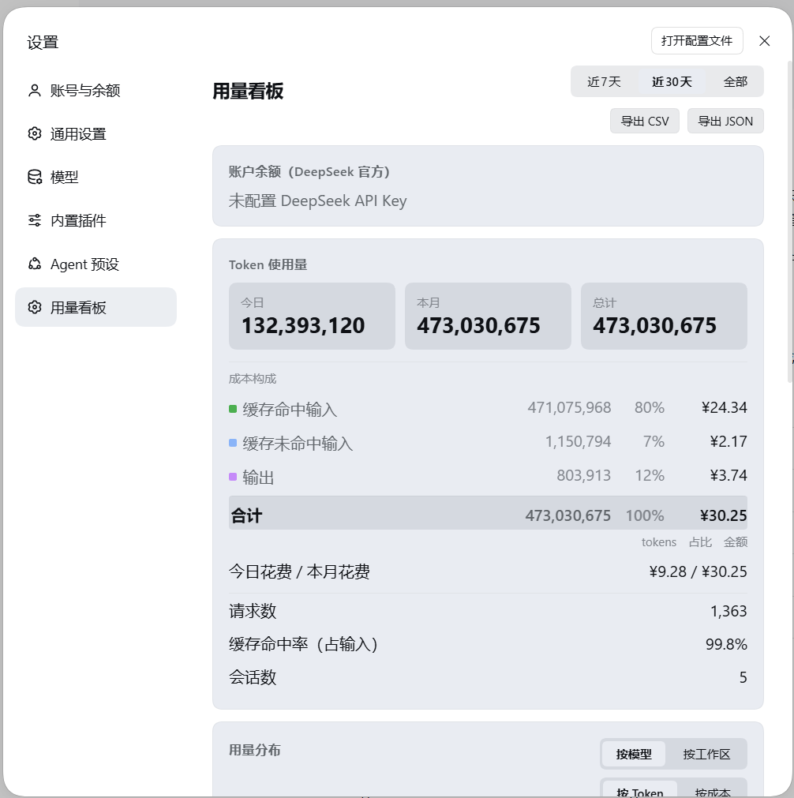
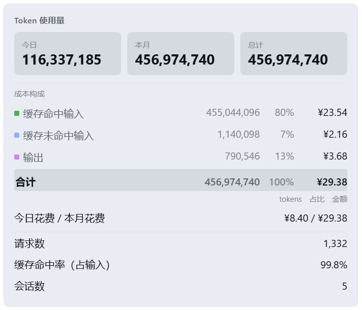
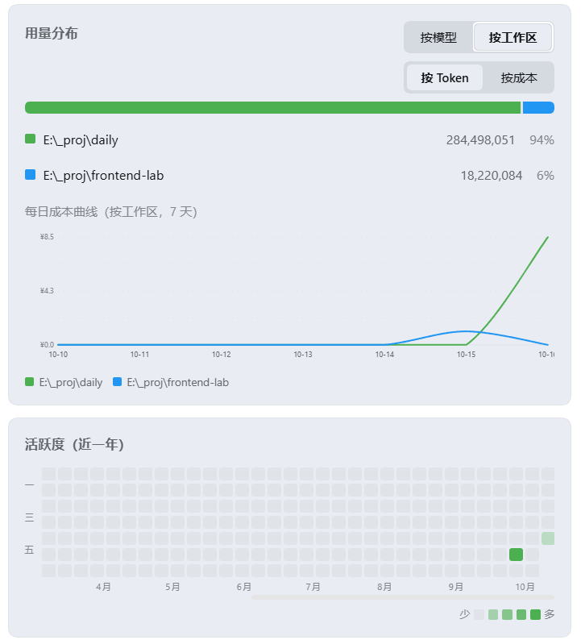

# dsh-token-dashboard

DeepSeek Harness 的用量看板：把**账户余额**、**Token 使用量**和**花费**放在一个页面里，按天、按模型、按工作区看清钱花在哪。

数据全部来自本地 —— 会话日志 + DeepSeek 官方余额接口，不需要额外的云端账号。



## 功能

### 余额

实时账户余额，走 DeepSeek 官方接口，自动识别 CNY / USD，可强制刷新。

### 用量

三张数字卡：**今日、近 7 天、近 30 天**（滚动窗口，含今天往前数）。加请求数、缓存命中率、会话数。顶部可切换全局时间范围：近 7 天 / 近 30 天 / 全部，影响图表和分布。

花费那里是两行：**今日花费始终显示**，另一行**跟随顶部所选档位** —— 选近 7 天显示近 7 天、选近 30 天显示近 30 天、选全部显示总计。这样标签和数字永远是同一个周期，也不会出现两张卡显示同一个数。

### 花费

按 DeepSeek 的三档计费**分别算出金额**：缓存命中输入、缓存未命中输入、输出。



计费口径：

- **峰谷价**：高峰为北京时间周一至周五 09:00–12:00、14:00–18:00，其余时段（含周末）减半。判断按事件自身的时间，因此不随查看时间或设备时区变化。
- **按日期分档计价**：DeepSeek 每次调价记为一个新档位，事件用**它自己那天生效的单价**计算。所以后来调价不会改写之前几天的金额。
- **实际为估算**：插件只读取会话日志里的 token 数，再乘自己的价目表，并不知道 DeepSeek 实际扣了多少。对账请以官方账单为准。
- **未知模型**会被按 Flash 档计价，并在 `/api/token-dashboard/stats` 的 `unpricedModels` 里列出，以免静默算错。

改价：编辑 `lib/index.js` 里的 `PRICE_TIERS`，新增一条 `{ from: "YYYY-MM-DD", models: { ... } }` 即可；不同时段的单价写成 `[高峰, 空闲]` 两个数。官方价目见 [DeepSeek 定价页](https://api-docs.deepseek.com/zh-cn/quick_start/pricing)，发布日期见[更新日志](https://api-docs.deepseek.com/zh-cn/updates)。`PRICING_GAPS` 记录了表里哪些数字不是官方来源。

### 分布与趋势

「用量分布」可切换**按模型 / 按工作区**，以及**按 Token / 按成本**，配占比条。每种分组各画一条**每日平滑曲线**，直接看出谁在什么时候用得多。

### 活跃度

整年热力图（53 周 × 7 天）。悬停可显示当天日期、Token 与花费。

下面这张图同时能看到分工作区曲线和整年热力图：



### 明细与导出

按模型明细表（请求数 + 三档花费）、最近会话列表，以及一键导出 CSV / JSON。

## 安装

```bash
dsh plugin --profile <profile> add @astralux/dsh-token-dashboard
```

装完**刷新**，看板出现在 **设置 → 用量看板**。

也可以从 GitHub 或本地目录安装：

```bash
dsh plugin --profile <profile> add github:LynnChrysteiin/dsh-token-dashboard
dsh plugin --profile <profile> add /本仓库的绝对路径
```

## 使用

1. 打开 **设置 → 用量看板**。
2. 顶部选时间范围（近 7 天 / 近 30 天 / 全部）。
3. 在「用量分布」里切换按模型 / 按工作区、按 Token / 按成本。
4. 鼠标移到热力图格子上看某一天的具体用量。
5. 需要留档就点「导出 CSV / 导出 JSON」。

## 配置

不用配置即可使用。想改的话，host 部分在 `lib/index.js` 里读这几个值：

| 项 | 默认 | 说明 |
|---|---|---|
| `sessionsRoot` | `$DSH_HOME/sessions` | 会话日志目录 |
| `balanceCacheMs` | `300000` | 余额缓存时长（5 分钟） |
| `sweepIntervalMs` | `60000` | 统计刷新间隔 |

也可以在 profile 的 patch 里覆盖整个价目表（`config.priceTiers`，结构与 `PRICE_TIERS` 相同，格式不合法时整份忽略并记一条 warning，回落到内置表）。改价方式见上面「花费」一节。

## 说明

- **金额是估算**：插件只读会话日志里的 token 数，再乘自己的价目表，并不知道 DeepSeek 实际扣了多少。对账以官方账单为准。
- **余额显示「未配置 DeepSeek API Key」**：说明你用的是账号态登录而不是 API Key。余额卡片会空着，**Token 与花费统计不受影响**（它们来自本地会话日志）。
- **没有构建步骤**：纯 JavaScript，无依赖。改 `lib/client.js` 刷新页面即可，改 `lib/index.js` 需要重启 DSH。

## 来源

Fork 自 [lyk308/dsh-token-dashboard](https://github.com/lyk308/dsh-token-dashboard)，MIT 许可，原作者 [@lyk308](https://github.com/lyk308)。本仓库在其基础上修好了 dsh 0.2.0-rc.2 的兼容问题（原版在这个版本上所有数字都读成 0），修正了按官方价目计价，并做了上面这些扩展。

## 许可证

[MIT](./LICENSE)
